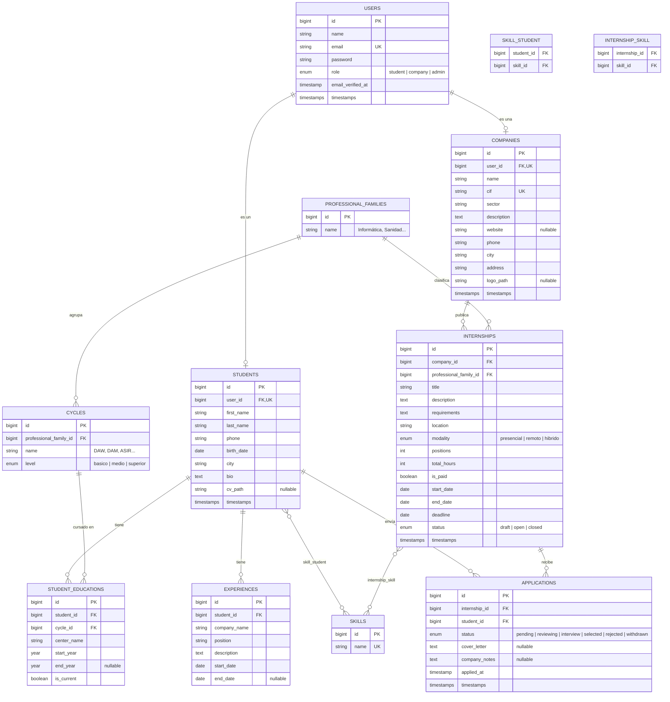
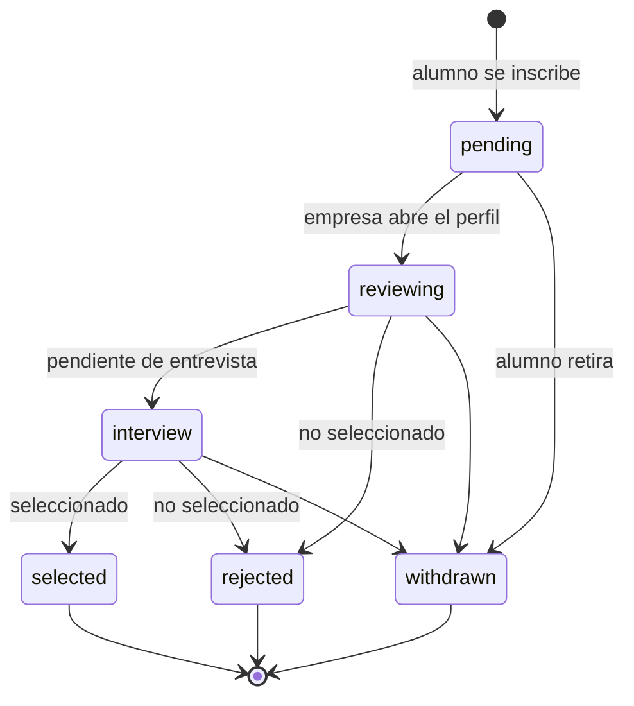

# App de prácticas FP: diseño de base de datos y estructura Laravel

> Cómo visualizarlo y editarlo: copia el bloque `mermaid` en https://mermaid.live (o abre este archivo en VS Code con la extensión "Markdown Preview Mermaid Support", o súbelo a GitHub). El diagrama es texto, así que se edita como código.

---

## 1. Diagrama Entidad-Relación



**Restricción importante:** en `applications` hay un índice único `(internship_id, student_id)` para que un alumno no se inscriba dos veces en la misma práctica.

---

## 2. Flujo de estados de una candidatura (`applications.status`)



Puedes simplificarlo a 4 estados (`pending`, `interview`, `selected`, `rejected`) si el proyecto debe ser más sencillo.

---

## 3. Estructura MVC en Laravel

### Modelos (`app/Models`) y relaciones Eloquent

| Modelo | Relaciones |
|---|---|
| `User` | `hasOne(Student)`, `hasOne(Company)` |
| `Student` | `belongsTo(User)`, `hasMany(StudentEducation)`, `hasMany(Experience)`, `belongsToMany(Skill)`, `hasMany(Application)` |
| `Company` | `belongsTo(User)`, `hasMany(Internship)` |
| `Internship` | `belongsTo(Company)`, `belongsTo(ProfessionalFamily)`, `belongsToMany(Skill)`, `hasMany(Application)` |
| `Application` | `belongsTo(Internship)`, `belongsTo(Student)` |
| `ProfessionalFamily` | `hasMany(Cycle)`, `hasMany(Internship)` |
| `Cycle` | `belongsTo(ProfessionalFamily)`, `hasMany(StudentEducation)` |
| `StudentEducation` | `belongsTo(Student)`, `belongsTo(Cycle)` |
| `Experience` | `belongsTo(Student)` |
| `Skill` | `belongsToMany(Student)`, `belongsToMany(Internship)` |

Ejemplo:

```php
// app/Models/Internship.php
class Internship extends Model
{
    protected $fillable = [
        'company_id', 'professional_family_id', 'title', 'description',
        'requirements', 'location', 'modality', 'positions', 'total_hours',
        'is_paid', 'start_date', 'end_date', 'deadline', 'status',
    ];

    protected $casts = ['is_paid' => 'boolean', 'deadline' => 'date'];

    public function company()  { return $this->belongsTo(Company::class); }
    public function family()   { return $this->belongsTo(ProfessionalFamily::class, 'professional_family_id'); }
    public function skills()   { return $this->belongsToMany(Skill::class); }
    public function applications() { return $this->hasMany(Application::class); }

    public function scopeOpen($q) { return $q->where('status', 'open')->where('deadline', '>=', now()); }
}
```

### Controladores (`app/Http/Controllers`)

Los middleware se declaran **dentro de cada controlador** (no en las rutas), tal como pide el profesor.

| Controlador | Rol | Middleware (en el controlador) | Acciones |
|---|---|---|---|
| `Auth/*` (Laravel Breeze) | todos | los gestiona Breeze | registro (elige alumno/empresa), login, logout |
| `StudentProfileController` | alumno | `auth`, `role:student` | `show`, `edit`, `update` |
| `EducationController` | alumno | `auth`, `role:student` | `store`, `update`, `destroy` |
| `ExperienceController` | alumno | `auth`, `role:student` | `store`, `update`, `destroy` |
| `CompanyProfileController` | empresa | `auth`, `role:company` | `show`, `edit`, `update` |
| `InternshipController` | público / empresa | `auth` y `role:company` **excepto** `index` y `show` | `index` y `show` (públicos); `create`, `store`, `edit`, `update`, `destroy` (solo empresa propietaria) |
| `ApplicationController` | alumno | `auth`, `role:student` | `index` (mis candidaturas), `store` (inscribirse), `destroy` (retirar) |
| `CompanyApplicationController` | empresa | `auth`, `role:company` | `index` (candidatos de una práctica), `show` (ver perfil del candidato), `updateStatus` |
| `DashboardController` | alumno / empresa | `auth` | redirige según el rol |

Ejemplo (Laravel 11/12, interfaz `HasMiddleware`):

```php
use Illuminate\Routing\Controllers\HasMiddleware;
use Illuminate\Routing\Controllers\Middleware;

class InternshipController extends Controller implements HasMiddleware
{
    public static function middleware(): array
    {
        return [
            // index y show son públicos; el resto exige empresa logueada
            new Middleware('auth', except: ['index', 'show']),
            new Middleware('role:company', except: ['index', 'show']),
        ];
    }
}

class ApplicationController extends Controller implements HasMiddleware
{
    public static function middleware(): array
    {
        return [
            new Middleware('auth'),
            new Middleware('role:student'),
        ];
    }
}
```

En Laravel 10 o anterior se hace en el constructor:

```php
public function __construct()
{
    $this->middleware('auth')->except(['index', 'show']);
    $this->middleware('role:company')->except(['index', 'show']);
}
```

### Rutas (`routes/web.php`)

```php
// Las rutas NO llevan middleware: cada controlador declara los suyos.

Route::get('/dashboard', DashboardController::class)->name('dashboard');

// Prácticas: index y show públicos; el resto lo protege el propio controlador
Route::resource('practicas', InternshipController::class)
    ->parameters(['practicas' => 'internship']);

// Alumno
Route::resource('perfil-alumno', StudentProfileController::class)->only(['show', 'edit', 'update']);
Route::resource('estudios', EducationController::class)->only(['store', 'update', 'destroy']);
Route::resource('experiencias', ExperienceController::class)->only(['store', 'update', 'destroy']);
Route::get('/mis-candidaturas', [ApplicationController::class, 'index'])->name('applications.index');
Route::post('/practicas/{internship}/inscribirse', [ApplicationController::class, 'store'])->name('applications.store');
Route::delete('/candidaturas/{application}', [ApplicationController::class, 'destroy'])->name('applications.destroy');

// Empresa
Route::resource('perfil-empresa', CompanyProfileController::class)->only(['show', 'edit', 'update']);
Route::get('/practicas/{internship}/candidatos', [CompanyApplicationController::class, 'index'])->name('company.applications.index');
Route::get('/candidaturas/{application}', [CompanyApplicationController::class, 'show'])->name('company.applications.show');
Route::patch('/candidaturas/{application}/estado', [CompanyApplicationController::class, 'updateStatus'])->name('company.applications.status');
```

### Vistas (`resources/views`, Blade)

```
layouts/app.blade.php
auth/            (login, register con selector de rol)
dashboard/       student.blade.php, company.blade.php
internships/     index.blade.php (listado + filtros), show.blade.php,
                 create.blade.php, edit.blade.php, _form.blade.php
student/         profile.blade.php, edit.blade.php
company/         profile.blade.php, edit.blade.php
applications/    index.blade.php (alumno)
company/applications/  index.blade.php (lista de candidatos), show.blade.php (+ selector de estado)
```

### Otras piezas

- **Middleware** `EnsureUserHasRole` (`role:student`, `role:company`), registrado como alias `role` en `bootstrap/app.php`. Se aplica desde cada controlador (ver sección de controladores).
- **Policies**: `InternshipPolicy` (solo la empresa propietaria edita/borra) y `ApplicationPolicy` (el alumno solo ve y retira las suyas; la empresa solo gestiona candidaturas de sus prácticas). Se comprueban dentro del método con `Gate::authorize('update', $internship)` o, desde el controlador, con `new Middleware('can:update,internship', only: ['edit', 'update', 'destroy'])`.
- **Form Requests**: `StoreInternshipRequest`, `UpdateStudentProfileRequest`, `UpdateApplicationStatusRequest` (valida que el estado esté en la lista permitida).
- **Enums PHP 8.1** (opcional): `ApplicationStatus`, `Modality`, `UserRole`, usados en los `casts`.
- **Seeders**: `ProfessionalFamilySeeder`, `CycleSeeder`, `SkillSeeder`, más datos de prueba con factories.

---

## 4. Orden de migraciones

El orden importa por las claves foráneas:

1. `users` (ya viene con Laravel; añade la columna `role`)
2. `professional_families`
3. `cycles`
4. `skills`
5. `students`
6. `companies`
7. `student_educations`
8. `experiences`
9. `skill_student`
10. `internships`
11. `internship_skill`
12. `applications`

Ejemplo de la tabla clave:

```php
Schema::create('applications', function (Blueprint $table) {
    $table->id();
    $table->foreignId('internship_id')->constrained()->cascadeOnDelete();
    $table->foreignId('student_id')->constrained()->cascadeOnDelete();
    $table->enum('status', ['pending', 'reviewing', 'interview', 'selected', 'rejected', 'withdrawn'])
          ->default('pending');
    $table->text('cover_letter')->nullable();
    $table->text('company_notes')->nullable();
    $table->timestamp('applied_at')->useCurrent();
    $table->timestamps();

    $table->unique(['internship_id', 'student_id']);
});
```

---

## 5. Ideas opcionales (si sobra tiempo)

- Tabla `application_status_logs` (`application_id`, `status`, `changed_at`) para guardar el historial de cambios de estado.
- Filtros en el listado: familia profesional, ciudad, modalidad, remuneradas.
- Subida de CV en PDF con `Storage` y `storage:link`.
- Rol `admin` para gestionar el catálogo de ciclos y habilidades.